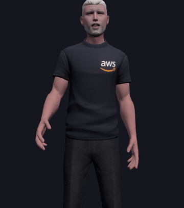

# livekit-avatar



A LiveKit voice agent that publishes a **behaviour stream** (gaze, emotion, gestures,
listening cues) alongside its audio, and renderers that turn it into body language.
Lip sync is derived from the audio on each device; the stream carries what audio can't.

- `agent/`: Python LiveKit agent (uv)
- `web/`: three.js client and dev token endpoint (Vite)
- `docs/behaviour-protocol.md`: the behaviour stream's wire format
- `tools/blender/transfer_shapes.py`: transfers ARKit blend shapes and visemes from one Ready Player Me-style avatar onto another
- `infra/`: Terraform for Azure Container Apps

## Blog series

How this was built, step by step, on [petexr.com](https://petexr.com):

1. [From CMP338 to LiveKit: where my talking avatars started](https://petexr.com/ai/avatars/aws/livekit/metahuman/unreal%20engine/2026/10/27/from-cmp338-to-livekit.html):
   the re:Invent 2024 MetaHuman demo, its AWS architecture, and what it was missing.
2. [A behaviour stream for LiveKit agents](https://petexr.com/ai/avatars/livekit/2026/10/27/a-behaviour-stream-for-livekit-agents.html):
   the idea behind this repo, and getting the agent and web client running from scratch.
3. [Giving my avatar a face, and a body that talks](https://petexr.com/ai/avatars/blender/2026/10/27/giving-my-avatar-a-face-and-a-body.html):
   blend-shape transfer, lip sync from audio, idle motion, weight shifts and talking gestures.

## Run

1. `cp agent/.env.local.example agent/.env.local` and fill in your LiveKit Cloud URL, key and secret.
   The example also sets `AVATAR_AGENT_NAME=avatar-agent-dev`, so local development doesn't compete
   with a deployed agent, and documents `AVATAR_VOICE` for choosing (or cloning) the voice.
2. Agent: `cd agent && uv run agent dev`
3. Web: `cd web && npm install && npm run dev`, then open http://localhost:5173 and **Join**.
   Open a second tab with a different name to see the agent turn between people.

### Avatars

No avatar models are included. The web client uses the first of these it finds:

- `web/public/avatar.glb`: a Ready Player Me / Mixamo-skeleton glTF. Blend shapes (ARKit names,
  Oculus visemes) drive the face, and finger bones drive the hands.
- `web/public/avatar.vrm`: a VRM model.
- otherwise, a built-in primitive figure (`?avatar=simple` forces it).

If your avatar has no blend shapes, `tools/blender/transfer_shapes.py` can copy them from one that
does. Keep the licence of the source model in mind.

Handy URL options: `?view=face` and `?view=body` change the framing. The **test triggers** panel
plays emotions and gestures without an agent, and **voice sample** plays
`web/public/voice-sample.wav` (not included) through the lip sync.

## Deploy to Azure

`infra/` holds Terraform for Azure Container Apps: a `web` app (client + token endpoint,
scales to zero) and an always-on `agent` app, with images in ACR pulled via managed identity.

```
az login
infra/deploy.sh          # builds images in ACR, applies Terraform, prints the share link
infra/agent.sh stop      # stop the always-on agent between test sessions (start / status)
terraform -chdir=infra destroy -var image_tag=x   # tear down
```

The share link includes an access key (`?key=…`); the token endpoint rejects requests without it.
Terraform state is local and contains the LiveKit secret, so keep `infra/*.tfstate` out of git.

## Licence

MIT. See [LICENSE](LICENSE).
